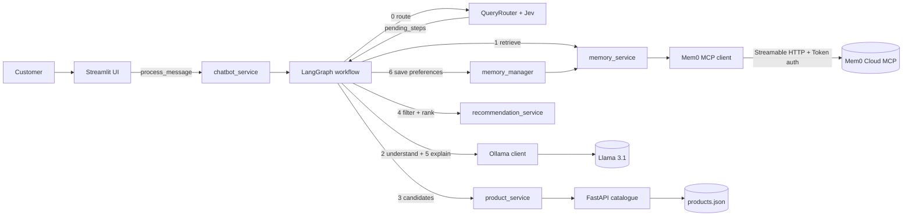
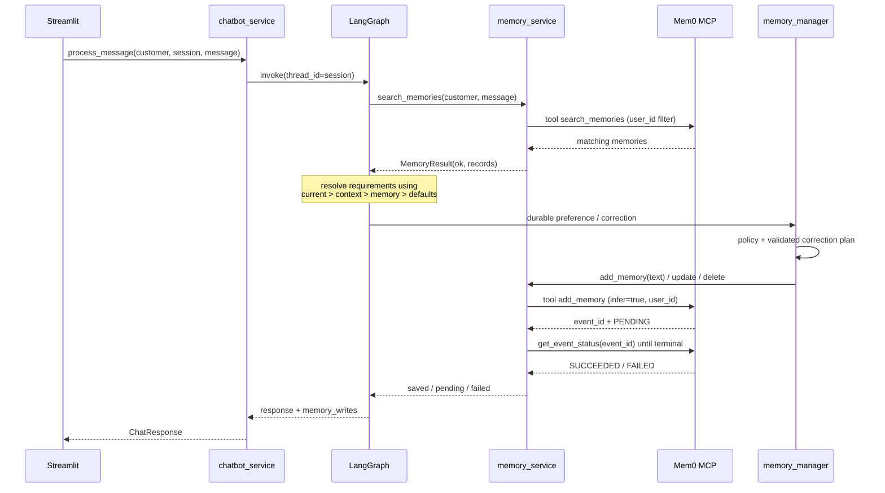

# Retail Memory Shopping Assistant

A small, working AI engineering POC that shows how a shopping assistant can
remember a customer's preferences **across conversations and application
restarts** using **Mem0 Cloud** through its official **MCP** server, local
**Ollama (Llama 3.1)** for language understanding, **LangGraph** for orchestration,
**FastAPI** for the product catalogue, deterministic Python for recommendations,
and **Streamlit** for the chat UI.

> The product catalogue is synthetic sample data. Prices and ratings are
> illustrative and do not represent live inventory or current market prices.

---

## 1. Problem statement

Most chat assistants forget everything when a conversation ends. A useful retail
assistant should remember stable preferences — for example "I usually prefer Sony
wireless headphones with noise cancellation" — and apply them the next time the
customer asks for a recommendation, without forcing them to repeat themselves.
At the same time, one-off requests such as "show me JBL under ₹3,000 this time"
must override the remembered brand **only for that purchase** and must not become
a permanent preference.

This POC demonstrates exactly that behaviour, end to end, with a real persistent
memory service.

## 2. Features

- A Jev (TypeSafe) query router that decides which operations each message
  needs, instead of running every node on every turn.
- Deterministic shortcuts, recall guards and a rules fallback, so a Jev outage
  never fails a customer turn.
- Natural-language shopping requests understood by local Llama 3.1.
- Long-term preferences stored and retrieved through Mem0 Cloud MCP.
- Persistent vs temporary preference rules (temporary budgets/gifts are not saved).
- Explicit precedence: current request → conversation context → memory → defaults.
- Follow-up messages ("Only Sony", "Under ₹5,000") refine the same request.
- Deterministic catalogue filtering and ranking (the LLM never picks products).
- Product cards with name, brand, price, rating and features.
- Per-customer memory isolation (`customer_001`, `customer_002`, `customer_003`).
- Memory inspection and deletion in the sidebar.
- Honest service status: Mem0, Ollama and product API are checked independently.
- Works from the terminal too (`python -m app.main`), because the chatbot service
  is frontend-independent.

## 3. Architecture



Responsibilities:

| Layer | Responsibility |
|---|---|
| `app/ui/streamlit_app.py` | Render chat, customer selector, product cards, memory panel. No business logic. |
| `app/services/chatbot_service.py` | Validate input, invoke LangGraph, return `ChatResponse`; status and memory helpers. Imports no Streamlit. |
| `app/agent/*` | State, prompts, nodes, graph compilation, checkpointer, step queue. |
| `app/routing/*` | Jev client, deterministic guards/fallback, validated `RouteDecision`, step planning. |
| `app/memory/memory_client.py` | Persistent MCP session, auth, tool discovery, schema adaptation, parsing. |
| `app/memory/memory_service.py` | Scoped add/search/list/update/delete, isolation, ownership checks. |
| `app/memory/memory_manager.py` | Persistent-vs-temporary policy, correction planning, truthful write reporting. |
| `app/products/*` | Product API HTTP client and candidate retrieval. |
| `app/recommendations/*` | Hard filtering and transparent ranking. |
| `app/llm/ollama_client.py` | Ollama chat/JSON calls with explicit errors. |
| `backend/*` | Product catalogue API and JSON data. |

A future FastAPI chatbot backend can call the same
`process_message(customer_id, session_id, message)` function; it is not
implemented in this POC by design.

## 4. Technology stack

| Component | Technology |
|---|---|
| Frontend | Streamlit 1.67 |
| Agent orchestration | LangGraph 1.2 (routed step queue) |
| Query router | Jev via TypeSafe `POST /v1/systemone` (`httpx`) |
| Local LLM | Ollama, `llama3.1` (configurable) |
| Memory | Mem0 Cloud, official MCP server |
| MCP client | Official Python `mcp` SDK (Streamable HTTP) |
| Product API | FastAPI 0.165 + Uvicorn |
| Product storage | JSON (28 synthetic products) |
| Recommendations | Pure Python |
| Tests | Pytest 9 |
| Configuration | `.env` + pydantic-settings |
| Environment/dependencies | uv (`pyproject.toml` + `uv.lock`, Python 3.13) |

## 5. Project structure

```
pyproject.toml                    # dependencies + dev group (uv source of truth)
uv.lock                           # locked dependency graph
.python-version                   # Python 3.13 pin for uv
requirements.txt                  # pip-compatible mirror
app/
  main.py                         # CLI smoke test
  config/settings.py              # environment configuration
  ui/streamlit_app.py             # Streamlit UI
  services/chatbot_service.py     # reusable chatbot entry point
  agent/{state,prompts,nodes,graph}.py
  routing/{models,questions,jev_client,rules,classifier}.py
  memory/{memory_client,memory_service,memory_manager}.py
  products/{product_client,product_service}.py
  recommendations/recommendation_service.py
  llm/ollama_client.py
backend/
  api.py                          # FastAPI app, /health
  routes/products.py              # catalogue endpoints
  data/products.json              # synthetic catalogue
tests/                            # pytest suite
scripts/check_services.py         # diagnostics / live Mem0 probe
docs/explanations/                # per-file + architecture documentation
```

Every Python file has a detailed explanation in `docs/explanations/`; start at
[docs/explanations/README.md](docs/explanations/README.md).

## 6. Data flow

1. The customer sends a message in Streamlit.
2. `chatbot_service.process_message` validates IDs and invokes the compiled graph
   with `thread_id = session_id`.
3. `prepare_turn` appends the message, preserves the previous shortlist and resets
   per-turn state.
4. `route_query` asks the `QueryRouter`. Greetings and explicit corrections are
   decided in Python; otherwise Jev classifies the message (or rules, when Jev is
   not configured/available). The result is a validated `RouteDecision` and an
   ordered `pending_steps` plan.
5. Only the planned nodes run:
   - `manage_memory` adds/corrects memories (corrections search first and only use
     returned ids; writes are confirmed by polling the Mem0 event);
   - `retrieve_memory` calls scoped `search_memories` when personalisation is
     needed;
   - `understand_request` asks Ollama for JSON requirements, validates with
     Pydantic, grounds each field against the message and resolves precedence;
   - `search_products` fetches a category/budget superset from FastAPI;
   - `recommend_products` filters and ranks deterministically.
6. `generate_response` produces exactly one reply: conversational, product,
   comparison, explanation, grounded memory answer, truthful memory confirmation
   or an explicit error.
7. `finalize_turn` appends the assistant message and closes the plan.
8. Streamlit renders the reply, product cards, route, real memory outcome and
   diagnostics.

## 7. Memory workflow



Rules:
- **Persistent:** preferred brands, product types, feature preferences, usual
  budget range, repeatedly expressed preferences.
- **Temporary:** a budget for this purchase, a one-off brand, a gift, a trip, a
  temporary colour.
- Mem0 performs extraction, de-duplication, merging and superseding with
  `infer=true`; the app no longer runs a duplicate extraction pipeline.
- Temporary items are never automatically promoted to memory.
- A write is "saved" only after its Mem0 event reports `SUCCEEDED`; a timeout is
  reported as pending, never as success.
- Corrections identify records through a scoped search and only use returned ids.

Customer isolation uses Mem0's `user_id` scope. Reads and writes always include
the customer ID, and any returned record naming a different user is discarded.
Update/delete verify ownership first.

## 8. Mem0 Cloud MCP configuration

1. Create a Mem0 Platform account and get an API key from
   <https://app.mem0.ai/dashboard/api-keys>.
2. Create your local env file from the template (`.env` is git-ignored):
   ```bash
   cp .env.example .env
   ```
3. Put the key in `.env` at the project root:
   ```dotenv
   MEM0_MCP_URL=https://mcp.mem0.ai/mcp
   MEM0_API_KEY=your-key-here
   ```
   Add the router key too (the app still runs without it, in deterministic rules
   mode):
   ```dotenv
   TYPESAFE_API_KEY=your-typesafe-key
   JEV_MODEL=jev-latest
   ```
   `.env` is read from the **current working directory**, so start the app from
   the project root. Restart Streamlit after editing it (settings are cached per
   process).
4. The client connects over **Streamable HTTP** and sends
   `Authorization: Token <MEM0_API_KEY>` — the API-key method documented by Mem0.
   Tool names and input schemas are discovered at runtime; nothing is guessed.
5. Verify:
   ```bash
   uv run python scripts/check_services.py            # connection status
   uv run python scripts/check_services.py --tools    # live tools + schemas
   uv run python scripts/check_services.py --live-memory-test
   ```
   The live probe adds a labelled memory, searches it, verifies another customer
   cannot retrieve it, then deletes it.

No Mem0 SDK or direct REST API is used by application code, and there is no local
Mem0 server.

## 9. Ollama setup

```bash
# macOS app (or: ollama serve on a standard install)
open -a Ollama
ollama pull llama3.1
ollama list
```

Configure in `.env` if needed:
```dotenv
OLLAMA_BASE_URL=http://localhost:11434
OLLAMA_MODEL=llama3.1
```

If Ollama or the model is missing, the assistant uses a deterministic extraction
fallback and clearly says the LLM is unavailable; it never pretends a generated
answer succeeded.

## 10. Python environment and dependencies (uv)

Requires Python 3.11+; `.python-version` pins 3.13 and uv installs it if needed.
Dependencies live in `pyproject.toml`, and `uv.lock` pins the full resolved set.

```bash
uv sync                       # creates .venv and installs locked deps (incl. dev)
cp .env.example .env          # then set MEM0_API_KEY
uv run python --version       # sanity check inside the project environment
```

Useful uv commands:

| Command | Purpose |
|---|---|
| `uv sync` | Create/update `.venv` from `uv.lock` (includes the dev group) |
| `uv sync --no-dev` | Runtime dependencies only |
| `uv lock` | Re-resolve `uv.lock` after changing `pyproject.toml` |
| `uv lock --upgrade` | Upgrade locked versions (review/test afterwards) |
| `uv add <package>` | Add a dependency and update the lock |
| `uv run <cmd>` | Run a command inside the project environment |
| `uv tree` | Inspect the resolved dependency graph |

`requirements.txt` is kept as a pip-compatible mirror for environments without uv
(`pip install -r requirements.txt`); `pyproject.toml` + `uv.lock` are authoritative.

## 11. Running the application

Start the services in separate terminals:

```bash
# 1) Product catalogue API
uv run uvicorn backend.api:app --reload --port 8000

# 2) Streamlit chatbot (Ollama must already be running)
uv run streamlit run app/ui/streamlit_app.py
```

Or use the helper script, which starts the API if it is not already running:

```bash
./run.sh
```

Open <http://localhost:8501>. Mem0 Cloud is remote; no local Mem0 process is
needed.

Terminal-only check:
```bash
uv run python -m app.main --customer customer_001 --message "Suggest headphones for me"
```

Opening the Streamlit page alone does not prove the system works. Check the
sidebar: Mem0 MCP, Ollama and the product API each show their real status.

## 12. Testing

```bash
uv run pytest                 # 173 unit / mocked-MCP / routing / workflow / e2e tests
uv run pytest -m live         # real Mem0 and Jev tests; require MEM0_API_KEY / TYPESAFE_API_KEY
```

Test files:
- `test_products.py` — product API endpoints and filters (FastAPI TestClient).
- `test_recommendations.py` — deterministic filtering/ranking.
- `test_memory.py` — MCP tool discovery, schema adaptation, customer isolation,
  ownership checks, memory rules. A fake MCP session exercises the real client
  plumbing. The `live` test contacts Mem0 Cloud.
- `test_routing.py` — Jev contract and failures, shortcuts, every guard, brand
  polarity, all 14 scenarios and plan invariants.
- `test_workflows.py` — compiled graph paths and behaviour for all required
  scenarios (conversation, memory questions, storage, corrections, search,
  comparison, refinement, combined turns).
- `test_agent.py` — new/existing customers, override precedence, temporary budget,
  follow-up context, memory/product/Ollama failures.
- `test_end_to_end.py` — full workflow through the real FastAPI catalogue, real
  recommendation engine and real graph; Mem0/Ollama faked.

Live Mem0 verification is deliberately separate from mocked tests. Do not treat a
green mocked suite as proof that the live service works.

## 13. Sample conversations

| Turn | Customer message | What happens |
|---|---|---|
| 1 | "Hi" | Conversational reply only; no catalogue or memory access. |
| 2 | "I usually prefer Sony headphones with noise cancellation." | `manage_memory` writes through Mem0 and confirms after the event completes. |
| 3 (new session) | "Recommend headphones based on my preferences." | Memory retrieved; Sony ANC headphones recommended. |
| 4 | "Which is better?" | Compares the previous shortlist without a new catalogue search. |
| 5 | "Show me cheaper ones." | Recomputes a budget below the previous minimum and searches again. |
| 6 | "I don't like JBL anymore; show me alternatives." | Deletes the JBL preference, excludes JBL and searches alternatives. |
| 7 (customer_002) | "What do you remember about me?" | Independent memory scope; no customer_001 memories. |

## 14. Verification status (honest)

| Area | Status |
|---|---|
| Product API (28 products, filters, 404) | TESTED |
| Recommendation engine | TESTED |
| LangGraph workflow + follow-ups | TESTED |
| Streamlit UI (AppTest, real chat turn) | TESTED |
| Ollama + Llama 3.1 real extraction/generation | VERIFIED LOCALLY |
| Mem0 MCP tool discovery and schemas | VERIFIED LIVE (11 tools) |
| Mem0 `add_memory` event id + `get_event_status` | VERIFIED LIVE (PENDING → SUCCEEDED) |
| Mem0 search/scoping/delete on a disposable customer | VERIFIED LIVE |
| Mem0 persistence across process restart | PARTIALLY VERIFIED — memories live in remote Mem0; the recall path is tested, but a full stop/start demo was not rerun |
| Jev live classification | **BLOCKED — no `TYPESAFE_API_KEY` in this environment** |
| Jev failure/fallback behaviour | TESTED with scripted errors and malformed answers |

The Jev HTTP contract was verified against the published API reference, and the
router has a skipped live test. Set `TYPESAFE_API_KEY` and run
`uv run pytest -m live` to exercise the real model.

## 15. Known limitations

- Mem0 writes are asynchronous (observed ~3 s); the app polls for up to 15 s and
  reports `pending` if the event has not finished.
- Feature-only corrections (no identifiable brand) report `not_found` rather than
  guessing which record to change.
- Jev receives the message plus two prior turns (never memories or customer ids).
- Conversation context is held in process memory (LangGraph `InMemorySaver`);
  restarting Streamlit clears the active thread. Long-term Mem0 memory persists.
- Requirement extraction relies on Llama 3.1 and is grounded by deterministic
  checks; unusual phrasing may be missed rather than guessed. Mem0 owns preference
  extraction.
- Brand matching requires the brand to appear in the message and catalogue.
- Memory-derived feature filters are soft and may be relaxed to avoid empty
  results; the relaxation is always disclosed.
- The catalogue is synthetic, and the app has no authentication — customer IDs
  are a demonstration of memory scoping, not a security boundary.

## 16. Future improvements

- Add a FastAPI `POST /chat` that calls the existing chatbot service (no graph
  rewrite needed).
- Add authentication and map real user accounts to Mem0 `user_id`s.
- Add streaming responses in Streamlit.
- Add more categories and richer catalogue metadata.
- Add an explicit memory-edit UI using the supported `update_memory` tool.
- Add retries/metrics for MCP calls and a persistent LangGraph checkpointer if
  conversation context must survive restarts.
