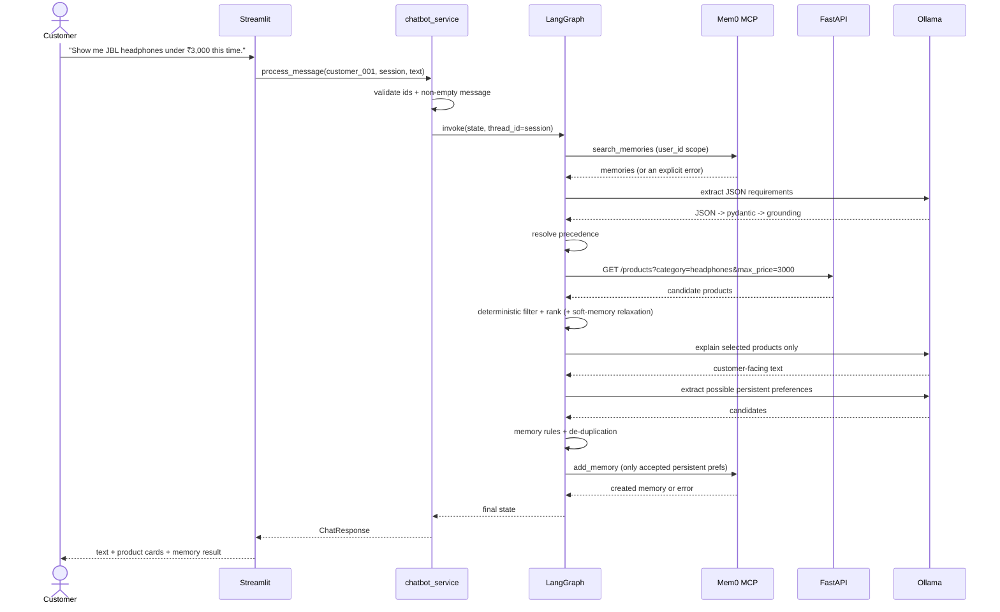

# Application workflow

This document follows one complete customer turn: from typing a message to
seeing a reply, product cards and a real memory result.

## High-level sequence



## Step-by-step

### 1. Streamlit input
`render_chat` appends the user's message to that customer's own chat list and
calls:

```python
process_message(customer_id, chat["session_id"], prompt)
```

Each customer has a separate `session_id` (e.g. `customer_001-a1b2c3d4`) and a
separate message list in `st.session_state`. Switching customers therefore cannot
show another customer's conversation.

### 2. Chatbot service validation
`process_message`:
- trims inputs;
- requires `customer_id` and `session_id` to match `^[A-Za-z0-9][A-Za-z0-9_-]{0,63}$`;
- rejects an empty message with a friendly response;
- obtains the process-wide compiled graph from `get_graph()`.

It never raises on user input problems; it returns `ChatResponse(ok=False, ...)`.

### 3. Graph invocation
LangGraph receives the new message plus `thread_id = session_id`. The
checkpointer restores that session's `conversation_history` and previous
`resolved_requirements`, which makes follow-ups work.

### 4. Memory retrieval
`retrieve_memory` calls `MemoryService.search_memories(customer_id, message)`.
Memories are returned as text sentences and stored in `customer_memories`.
Failures set `memory_status` to `error`, `unavailable` or `not_configured` and add
a diagnostic; the turn continues.

### 5. Request understanding
`understand_request` asks Ollama for a JSON object describing **only** the
current message:
- category, brand, budget, wireless, noise cancellation, required/excluded
  features, `is_shopping_request`, `refines_previous_request`.

The JSON is validated by `RequirementExtraction` (Pydantic) and then *grounded*:
- category must appear as a category word in the message;
- brand must appear in the message and in the catalogue;
- budget requires a digit in the message;
- wireless/noise cancellation must be mentioned;
- features are mapped from keywords.

Fields the message does not mention become `None`, so the precedence step can
fill them from the conversation or memory. This prevents a previous request from
leaking into the "current" extraction.

### 6. Precedence resolution
For each field (category, brand, budget, wireless, noise cancellation):
1. current explicit value;
2. previous resolved requirement, only when the message refines the previous
   request **and** does not switch category;
3. memory-derived hint;
4. default category `headphones`.

Memory-derived values are recorded in `memory_applied` for the soft-memory rule.

### 7. Product search
`search_products` calls the FastAPI catalogue with the resolved category and
maximum budget. This is a *superset*; brand/features are applied by the
recommendation engine. A product API failure sets `product_status="error"` and
no products.

### 8. Recommendation
`recommend_products` applies all hard filters and ranks rating desc → price asc →
product ID. If a memory-only wireless/ANC filter yields no results, it retries
without those memory-derived filters and records the relaxation. Explicit current
requirements are never relaxed.

### 9. Response generation
- Product API error → fixed honest message, no products.
- No matches → deterministic explanation naming the requirements.
- Products exist → Ollama writes the explanation using only the provided product
  data, with a note about any relaxed remembered preference.
- Ollama failure → the response states the products were found but the LLM
  explanation is unavailable, and includes the error.

### 10. Memory update
`update_memory`:
1. Appends the assistant reply to conversation history (capped at 12 messages).
2. Skips writing if memory retrieval failed (can't de-duplicate safely).
3. Asks Ollama for persistent/temporary candidates.
4. Lets `MemoryManager` keep persistent, non-duplicate candidates.
5. Calls Mem0 `add_memory` for each accepted candidate.
6. Reports the real result in `memory_writes`.

Saved text is only shown in the UI when the MCP call returned success.

### 11. Response to the UI
`ChatResponse` carries:
`response`, `recommendations`, `memory_status`, `memory_saved`,
`memory_writes`, `requirements`, `relaxed_preferences`, `product_status`,
`llm_status`, `errors`.

The UI renders the text, one card per product, a "Saved to Mem0" notice when
confirmed, a relaxation note, and a Diagnostics expander for errors/statuses.

## Worked example

Initial memory:
> Usually prefers Sony headphones with noise cancellation.

Message: **"Show me JBL headphones under ₹3,000 this time."**

1. Memory retrieved → Sony + ANC hints.
2. Grounded extraction → brand JBL, budget 3000, category headphones.
3. Resolution → JBL (current) overrides Sony (memory); budget 3000 (current);
   wireless None; ANC filled from memory → would exclude the cheap JBL models.
4. Candidates from API: category headphones, price ≤ 3000.
5. First ranking with ANC → empty. Memory-derived ANC is relaxed.
6. Result: JBL Tune 520BT (₹2,499), JBL Tune 510BT (₹1,999).
7. Preference extraction labels the budget/brand request `temporary` → nothing
   saved. UI shows no "Saved to Mem0" notice.
