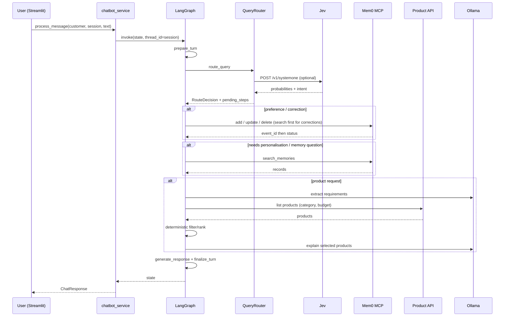

# Application workflow

## 1. One turn, end to end

## 2. Steps in detail

1. **Validation** — `process_message` checks `customer_id`, `session_id` and a
   non-empty message against `ID_PATTERN`.
2. **Preparation** — `prepare_turn` appends the user message, preserves history
   and previous shortlist, resets per-turn state.
3. **Routing** — `route_query` asks the `QueryRouter`. Greetings and explicit
   corrections are decided in Python; otherwise Jev classifies (or rules, when
   Jev is unconfigured/unavailable). The result is a validated `RouteDecision`
   and an ordered plan.
4. **Memory management** (if planned) — corrections search first, validate
   candidate ids, then update/delete. New durable preferences go through policy
   and are written with `infer=true`. Every write is confirmed by polling
   `get_event_status`.
5. **Memory retrieval** (if planned) — scoped search; failure is reported, not
   fabricated.
6. **Understanding** (if planned) — Ollama extraction, grounding, follow-up
   refinement, precedence resolution. Memory fills only unspecified fields.
7. **Catalogue** — category/budget candidates from FastAPI, then deterministic
   filtering and ranking. The LLM never selects products.
8. **Response** — one mode chosen from the route and results: conversational,
   product, comparison, explanation, memory, confirmation or error.
9. **Finalisation** — assistant message appended, queue emptied.

## 3. What each kind of message does

| Message | Memory | Catalogue | Ollama |
|---|---|---|---|
| "Hi" | no | no | conversation |
| "What is noise cancellation?" | no | no | conversation |
| "What do you remember about me?" | read | no | no (deterministic answer) |
| "I usually prefer Sony headphones" | write | no | no (policy + confirmation) |
| "Forget that I prefer Sony" | search + delete | no | no |
| "Show me earbuds under ₹5,000" | no | yes | extraction + explanation |
| "Recommend headphones based on my preferences" | read | yes | extraction + explanation |
| "Which is better?" | no | no (reuses shortlist) | comparison |
| "Show me cheaper ones" | no | yes (refined) | extraction + explanation |

## 4. Precedence

1. Current explicit instruction (grounded against the message).
2. Current conversation context (only for a refining follow-up).
3. Retrieved long-term memory (only when personalisation is requested or a field
   is unspecified).
4. Application defaults (`headphones`).

Temporary purchase constraints (budget, gift, "this time") never become durable
memories.

## 5. Error behaviour

| Failure | User sees |
|---|---|
| Mem0 read down | answer without personalisation + explicit note |
| Mem0 write rejected | "I couldn't complete that memory change" + diagnostic |
| Mem0 write pending | "still processing ... can't confirm it is saved yet" |
| Catalogue down | "couldn't reach the product catalogue" |
| Ollama extraction down | deterministic extraction; `llm_status=degraded` |
| Ollama chat down | results listed, explanation unavailable |
| Jev down | rules routing; `source=fallback` in diagnostics |

No failure is reported as success.

## 6. After the turn

`ChatResponse` exposes the text, recommendations, memory status/actions/events,
requirements, relaxed preferences, route, guards, router usage, response kind,
execution path and errors. The UI renders products, memory outcome and an
expandable diagnostics panel.
