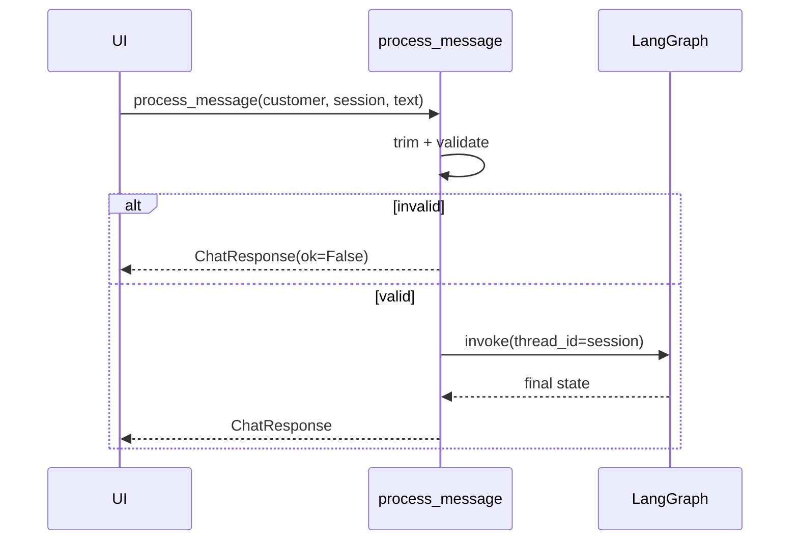

# `app/services/chatbot_service.py`

## 1. File purpose

The reusable boundary between any frontend and the LangGraph workflow. Streamlit
calls this module; a future FastAPI `POST /chat` could call the same function. It
contains no Streamlit code and returns validated structured data.

It also exposes service-status and memory-management helpers so the UI never
imports MCP or agent internals.

## 2. Imports and dependencies

| Import | Why |
|---|---|
| `re` | Identifier validation |
| `pydantic.BaseModel`, `Field` | `ChatResponse` validation |
| `app.agent.graph.get_graph` | Process-wide compiled workflow |
| `app.llm.ollama_client.ollama_status` | Ollama status |
| `app.memory.memory_service` (`get_memory_service`, `MemoryResult`, `MemoryServiceStatus`) | Memory calls/status |
| `app.products.product_service.product_api_status` | Product API status |

No Streamlit import; `test_end_to_end.py` verifies this in a subprocess.

## 3. Classes

### `ChatResponse(BaseModel)`

Structured result of one turn.

| Field | Type | Meaning |
|---|---|---|
| `ok` | `bool` | Request was processed (not necessarily found products) |
| `customer_id`, `session_id` | `str` | Echo of identifiers |
| `response` | `str` | Customer-facing text |
| `recommendations` | `list[dict]` | Catalogue products, unchanged |
| `memory_status` | `str` | `success`, `empty`, `error`, `not_configured`, `unknown` |
| `memory_saved` | `list[str]` | Texts confirmed saved through MCP |
| `memory_pending` | `list[str]` | Texts Mem0 accepted but has not finished |
| `memory_writes` | `dict` | Full report: status/saved/pending/skipped/failures/attempted |
| `memory_actions` | `list[dict]` | Per-operation verified outcome (add/update/delete) |
| `memory_events` | `list[dict]` | Event ids with their final status |
| `requirements` | `dict` | Resolved requirements |
| `relaxed_preferences` | `list[str]` | Memory filters relaxed for an empty result |
| `product_status` | `str` | `success`, `empty`, `error`, `unknown` |
| `llm_status` | `str` | `success`, `degraded`, `error`, `unknown` |
| `route` | `dict` | Serialised `RouteDecision` (flags, probabilities, source, confident) |
| `route_guards` | `list[str]` | Deterministic guards applied after Jev |
| `router_usage` | `dict` | Model, input tokens, latency |
| `response_kind` | `str` | Which response mode ran |
| `execution_path` | `list[str]` | Nodes actually visited |
| `errors` | `list[str]` | Diagnostics; never hidden |

No constructor logic beyond model defaults; validation happens in `process_message`.

## 4. Functions and methods

### `_id_error(field_name: str, value: str) -> ChatResponse | None`

Returns an error response when an identifier is empty or does not match
`^[A-Za-z0-9][A-Za-z0-9_-]{0,63}$`; otherwise `None`.

- Used for `customer_id` and `session_id`.
- Keeps validation consistent and avoids raising for bad user input.

### `process_message(customer_id, session_id, message, graph=None) -> ChatResponse`

Main entry point.

Parameters:
- `customer_id` — used as the Mem0 `user_id` scope.
- `session_id` — LangGraph `thread_id` for conversation context.
- `message` — non-empty customer text.
- `graph` — optional pre-built graph for tests.

Steps:
1. Trim all inputs.
2. Validate IDs via `_id_error`.
3. Reject an empty message with a friendly response.
4. Get the compiled graph (`graph or get_graph()`).
5. Invoke with:
   ```python
   {"customer_id": ..., "session_id": ..., "user_message": ...}
   config={"configurable": {"thread_id": session_id}}
   ```
6. Map state to `ChatResponse`, including real `memory_saved` and
   `relaxed_preferences`.
7. Catch unexpected exceptions and return `ok=False` with the error message.

Returns: `ChatResponse`. It does not raise for expected failures.

### `check_services() -> dict[str, Any]`

Collects:
```python
{
  "memory": {"ok": bool, "configured": bool, "message": str, "tools": [...]},
  "ollama": {"ok": bool, "message": str},
  "product_api": {"ok": bool, "message": str},
}
```
Used by the sidebar. Memory status does not raise; transport errors are converted
to a message.

### `list_customer_memories(customer_id) -> MemoryResult`

Delegates to `MemoryService.list_memories`; supports the inspection panel.

### `delete_customer_memory(customer_id, memory_id) -> MemoryResult`

Delegates to `MemoryService.delete_memory` (ownership verified there).

### `clear_customer_memories(customer_id) -> MemoryResult`

Delegates to `MemoryService.delete_all_memories`, scoped to the customer.

## 5. Execution workflow



## 6. Input and output

Input:
```python
process_message("customer_001", "customer_001-a1b2c3d4", "Suggest headphones")
```

Output (abridged):
```python
ChatResponse(
    ok=True,
    customer_id="customer_001",
    session_id="customer_001-a1b2c3d4",
    response="...",
    recommendations=[{...}],
    memory_status="success",
    memory_saved=[],
    product_status="success",
    llm_status="success",
    errors=[],
)
```

## 7. Interaction with other modules

- Streamlit and `app/main.py` call it.
- It calls the compiled graph and the status/memory helpers.
- It never imports Streamlit, MCP client details, prompts or catalogue code.

## 8. Important implementation decisions

- Failures are returned, not raised, so a frontend can always render something.
- `memory_saved` is sourced from the graph's write report, which only contains
  writes whose Mem0 event reported `SUCCEEDED` (pending writes go to
  `memory_pending`, never `memory_saved`).
- `check_services()` also reports router mode (`Jev router ready` or
  `Deterministic rules mode`).
- `memory_actions` carries each add/update/delete with its verified status.
- `execution_path` exposes which nodes ran, which makes routing testable from
  the public API as well as from graph state.
- Identifier validation prevents an empty or path-like customer id from reaching
  the memory layer.
- Future FastAPI compatibility: the signature and return model are transport
  agnostic; no request/response classes from FastAPI are used.

## 9. Example execution

```python
from app.services.chatbot_service import process_message

response = process_message("customer_002", "demo-1", "Show me JBL headphones under ₹3,000")
print(response.response)
for product in response.recommendations:
    print(product["name"], product["price"])
```
