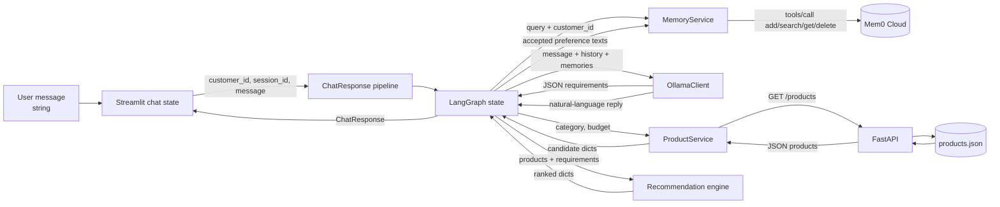
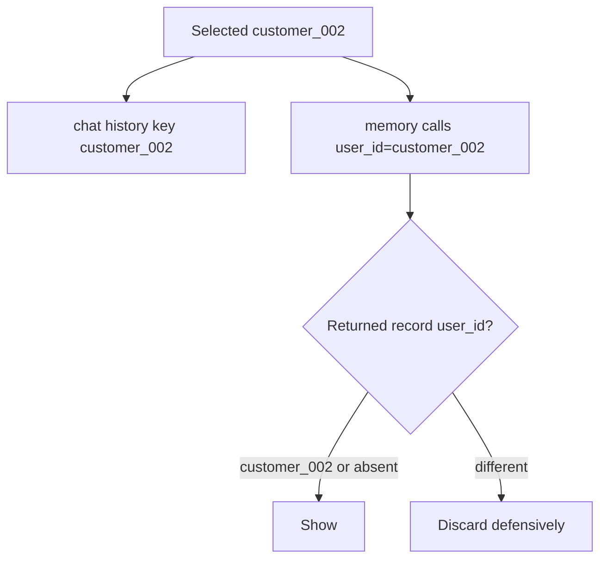

# Data flow

## End-to-end data movement



## Data shapes

### Message into the system
```python
{"customer_id": "customer_001", "session_id": "customer_001-a1b2c3d4", "message": "Suggest headphones"}
```

### Memory record (application shape)
```python
MemoryRecord(
    memory_id="f4cbdb08-...",       # from Mem0 id/memory_id
    text="Usually prefers Sony headphones with noise cancellation.",
    metadata={"source": "retail-memory-assistant"},
    score=0.82,
    created_at="2026-11-19T...",
    user_id="customer_001",
)
```

### Requirements after resolution
```python
{
  "category": "headphones",
  "brand": "Sony",
  "max_budget": 5000.0,
  "wireless": True,
  "noise_cancellation": True,
  "required_features": [],
  "excluded_features": [],
  "excluded_brands": [],
  "excluded_product_ids": [],
}
```

### Recommendation (catalogue shape, unchanged)
All catalogue fields are preserved so the UI and LLM see the same source of truth:
`product_id`, `name`, `brand`, `category`, `price`, `rating`, `wireless`,
`noise_cancellation`, `features`.

### Chat response
```python
ChatResponse(
    ok=True,
    customer_id="customer_001",
    session_id="customer_001-a1b2c3d4",
    response="Based on your preferences, here are ...",
    recommendations=[...],
    memory_status="success",
    memory_saved=["Usually prefers Sony headphones ..."],
    memory_writes={"status": "success", "saved": [...], "skipped": [...], ...},
    requirements={...},
    relaxed_preferences=[],
    product_status="success",
    llm_status="success",
    errors=[],
)
```

## Per-component inputs and outputs

| Component | Input | Output |
|---|---|---|
| Streamlit | user text, selected customer | rendered messages, cards, statuses |
| `process_message` | customer/session/message | `ChatResponse` |
| `prepare_turn` | state | updated history, reset fields |
| `retrieve_memory` | customer, message | memory texts, status |
| `understand_request` | message, history, memories, brands | grounded requirements + resolution |
| `search_products` | category, budget | candidate product list |
| `recommend_products` | products, requirements | ranked recommendations |
| `generate_response` | requirements, memories, products | response text |
| `update_memory` | message, history, existing memories | write report |
| `MemoryService` | customer-scoped calls | `MemoryResult` |
| `Mem0MCPClient` | tool name + arguments | normalised payload |
| `ProductService` | filters | product dicts |
| `ProductAPIClient` | HTTP filters | JSON products |
| `OllamaClient` | chat messages | text / parsed JSON |
| FastAPI | query params | filtered catalogue JSON |

## Persistence boundaries

| Data | Stored where | Survives restart? |
|---|---|---|
| Long-term preferences | Mem0 Cloud | Yes |
| Current chat messages | Streamlit session state | No |
| Conversation context for follow-ups | LangGraph `InMemorySaver` | No |
| Product catalogue | `backend/data/products.json` | Yes |
| Configuration | environment / `.env` | Yes |

Clearing a conversation changes the UI's session id and messages; it does not call
a memory deletion tool. Deleting memories is a separate, explicit sidebar action.

## Isolation flow



The UI keeps separate message lists per customer, so even in-process state cannot
mix conversations.
