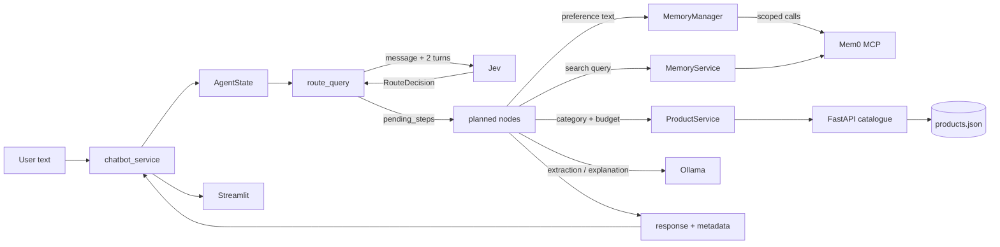

# Data flow

## 1. Turn-level flow



## 2. What crosses each boundary

| Boundary | Data sent | Data returned |
|---|---|---|
| UI → `chatbot_service` | customer id, session id, message | `ChatResponse` |
| `chatbot_service` → graph | identity + message | full state |
| graph → Jev | message + up to 2 prior turns | probabilities, intent, tokens |
| graph → Mem0 | customer-scoped queries, preference text, validated ids | records, event ids, statuses |
| graph → Product API | category, max budget | product dicts |
| graph → Ollama | prompts + grounded context | JSON requirements or text |
| graph → UI | response, recommendations, diagnostics | — |

## 3. Product data

`products.json` is read only by FastAPI. The application receives product
dictionaries, filters and ranks them in Python, and passes the selected list to
Ollama for explanation. `recommendation_service` is the only ranking authority.

## 4. Memory data

| Direction | Shape |
|---|---|
| `add_memory` request | `text`/`messages`, `user_id`, `metadata`, `infer` |
| `add_memory` response | `{event_id, status: "PENDING"}` |
| `get_event_status` | `status`, `results[].id`, `results[].data.memory` |
| `search_memories` | `{results: [{id, memory, user_id, score, metadata}]}` |
| `update_memory` / `delete_memory` | `memory_id` only; ownership checked first |

`MemoryRecord` normalises records; `MemoryAction` normalises outcomes.

## 5. Router data

```python
RouteDecision(
    intent="product_search",
    wants_products=True,
    needs_personalisation=False,
    followup_action="none",
    probabilities={"wants_products": 0.97, ...},
    source="jev",
    confident=True,
    model="jev-latest",
    input_tokens=428,
    latency_ms=210,
    guards=[],
)
```

`router_usage` and `route_guards` are copied into state and surfaced in
`ChatResponse`.

## 6. Conversation data

LangGraph checkpoints `conversation_history` (last 12 messages),
`resolved_requirements` and `previous_recommendations` per `thread_id`.
`prepare_turn` moves the last shortlist into `previous_recommendations` so
compare/explain follow-ups need no new catalogue query.

## 7. Privacy boundaries

- Jev: message + two turns only.
- Mem0: customer-scoped preference text and ids.
- Ollama: local prompts; may include retrieved memories, never API keys.
- No secret is logged; `.env` stays out of source control.
