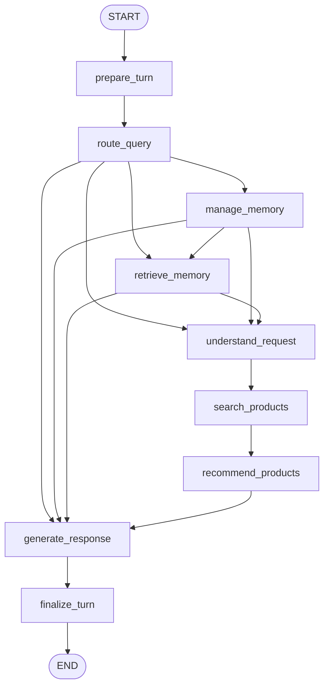

# LangGraph workflow

## 1. Why LangGraph

The assistant needs an auditable execution plan per message and checkpointed
conversation context. LangGraph provides both: `route_query` writes the plan,
shared conditional edges execute it, and `InMemorySaver` keeps each session's
history and previous shortlist.

## 2. Graph



Every node except `prepare_turn`/`finalize_turn` is reached through the shared
`next_step` conditional edge reading `pending_steps[0]`.

## 3. Step queue

```python
def next_step(state) -> str:
    steps = state.get("pending_steps") or []
    if not steps:
        return END
    candidate = steps[0]
    if candidate not in PLANNED_NODES:
        return "finalize_turn"
    ...
```

Each node calls `_consume(state, name)`, which:

1. verifies it is the head of the queue and pops exactly its own entry;
2. appends itself to `visited_steps`;
3. records an error if the order is wrong or the node was not scheduled;
4. truncates to `["finalize_turn"]` when 12 nodes have run.

All destinations are registered in `dispatch_map()`; `next_step` only emits
allowlisted names, and Jev never supplies a node name.

## 4. State

See `agent_state.md`. Routing additions:

```python
route: dict
pending_steps: list[str]
visited_steps: list[str]
router_usage: dict
route_guards: list[str]
previous_recommendations: list[dict]
response_kind: str
memory_actions: list[dict]
memory_events: list[dict]
```

Per-turn fields are reset by `prepare_turn`; `conversation_history`,
`resolved_requirements` and the previous shortlist survive.

## 5. Checkpointing and sessions

```python
builder.compile(checkpointer=InMemorySaver())
graph.invoke(state, config={"configurable": {"thread_id": session_id}})
```

`thread_id` is the session id. A new chat gets a new session id, so old thread
state is never reused; Mem0 memories are unaffected. Restarting the process
clears conversation context only.

## 6. Node responsibilities

| Node | Runs when | Does |
|---|---|---|
| `prepare_turn` | always | reset turn state, append user message, save previous shortlist |
| `route_query` | always | Jev/rules classification and step plan |
| `manage_memory` | correction or durable preference | add/correct/update/delete via Mem0, poll event |
| `retrieve_memory` | personalisation or memory question | scoped search |
| `understand_request` | product request (not compare/explain) | extract, ground, refine, resolve precedence |
| `search_products` | same | fetch category/budget candidates |
| `recommend_products` | same | filter, rank, relax memory-only constraints |
| `generate_response` | always | one response in the appropriate mode |
| `finalize_turn` | always | append assistant reply, empty queue |

## 7. Follow-up example

| Message | Plan | Resolved requirements |
|---|---|---|
| "Show me wireless headphones." | understand, search, recommend, generate, finalize | wireless=true, category=headphones |
| "Only Sony." | understand, search, recommend, generate, finalize | + brand=Sony, keeps wireless |
| "Under ₹5,000." | understand, search, recommend, generate, finalize | + budget=5000, keeps brand/wireless |
| "Which is better?" | generate, finalize | reuses previous shortlist, no fetch |
| "Show me cheaper ones" | understand, search, recommend, generate, finalize | budget = cheapest previous − 1 |

## 8. Failure handling

| Failure | Effect |
|---|---|
| Router failure | safe conversational plan |
| Node exception | propagates to `process_message`, which returns an explicit error response |
| Bad plan entry | `next_step` routes to `finalize_turn` |
| Repeated/too many steps | queue truncated at `MAX_VISITED_STEPS` |
| Memory/product/Ollama failure | node-specific status and honest response text |

## 9. Testing

`tests/test_routing.py` verifies plan invariants and the dispatcher.
`tests/test_workflows.py` runs the compiled graph and asserts
`execution_path` for every required scenario.
`tests/test_agent.py` and `tests/test_end_to_end.py` cover precedence, failures
and the real catalogue (with fake Mem0/Ollama).
