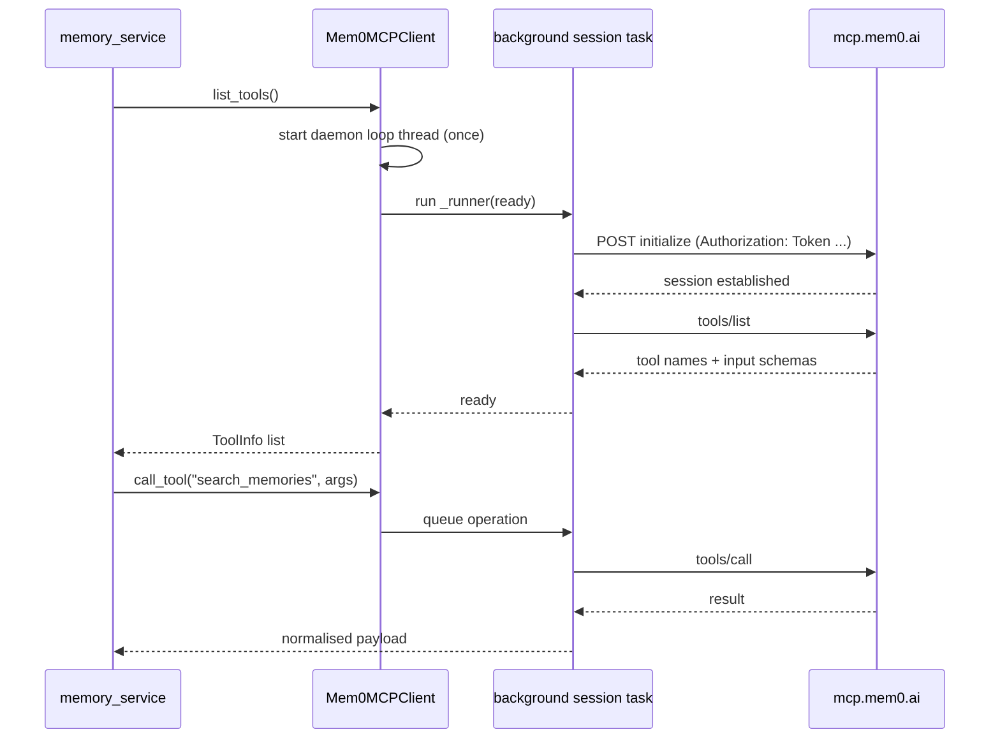

# Memory workflow — Mem0 Cloud over MCP

## Verified service contract

Before implementation, the official Mem0 documentation was consulted:

- Hosted endpoint: `https://mcp.mem0.ai/mcp`
- Transport: **Streamable HTTP** (`mcp.client.streamable_http`)
- API-key auth header: `Authorization: Token <MEM0_API_KEY>`
- Tools: `add_memory`, `search_memories`, `get_memories`, `get_memory`,
  `update_memory`, `delete_memory`, `delete_all_memories`, `delete_entities`,
  `list_entities`, plus event tools.

The Python MCP SDK is used (`mcp==2.3.0`). The Mem0 SDK and direct REST calls are
not used anywhere.

Tool input schemas are discovered at runtime with `list_tools()`. Arguments are
adapted to the discovered schema (`build_arguments`), so the app does not guess
whether `add_memory` expects `messages` or `text`, or whether `get_memories`
accepts `filters`.

## Connection lifecycle



Design points:
- One MCP session per process, owned by a single background asyncio task. The
  session and its anyio task group must stay in one task; queueing operations to
  that task satisfies this and lets Streamlit reruns reuse the connection.
- Requests block with a timeout (`MEM0_TIMEOUT_SECONDS`, default 30s).
- Connection/auth errors are classified into `Mem0NotConfiguredError`,
  `Mem0AuthenticationError` or `Mem0MCPError` and returned to callers as failed
  `MemoryResult`s (never silent success).
- The key is never logged; only its presence is reported.

## Operations

| Application method | MCP tool | Scope |
|---|---|---|
| `add_memory(customer, text)` | `add_memory` | `user_id=customer`, `messages`/`text` per schema |
| `search_memories(customer, query)` | `search_memories` | `filters={"AND":[{"user_id": customer}]}` |
| `list_memories(customer)` | `get_memories` | same filter, page/page_size |
| `update_memory(customer, id, text)` | `update_memory` | ownership verified first |
| `delete_memory(customer, id)` | `delete_memory` | ownership verified first |
| `delete_all_memories(customer)` | `delete_all_memories` | customer filter, confirmation candidate |

If the discovered schema accepts neither `user_id` nor `filters`, the service
refuses the operation. That is deliberate: an unscoped call could read or delete
another customer's memories.

## Customer isolation

1. `customer_id` is used as the Mem0 `user_id` on every write.
2. Every read includes an `AND` filter with that `user_id`.
3. Returned records that name a different `user_id` are discarded defensively.
4. Update/delete call `get_memories` and require the memory id to be present in the
   customer's scope before mutating it.
5. A test simulates a server returning two users' records and asserts only the
   owner's record is surfaced.

The UI also keys chat history and memory panels by customer, so switching customers
never displays the previous customer's data.

## Persistent vs temporary preferences

Extraction (Ollama) proposes candidates; rules (Python) decide.

**Stored (`persistent`):**
- preferred brands: "Usually prefers Sony headphones."
- product type: "Prefers over-ear headphones."
- features: "Always prefers wireless headphones with noise cancellation."
- usual budget: "Usually has a budget around ₹5,000."

**Not stored (`temporary`):**
- "Budget of ₹3,000 for this purchase."
- "Wants JBL instead of Sony this time."
- "Looking for a gift."
- "Needs headphones for an upcoming trip."
- "Wants black for this order."

Deterministic guard (`memory_manager.py`):
- reject `kind != "persistent"`;
- reject temporary markers ("this time", "this purchase", "for a gift", "trip",
  "today", etc.);
- require at least 8 normalised characters;
- require stable-preference wording ("usually", "prefer", "always", ...) unless the
  model's confidence is ≥ 0.7;
- reject budget-only sentences unless they use stable wording (so "Budget under
  ₹3,000" is skipped, while "Usually has a budget around ₹5,000" is kept);
- reject near-duplicates (`SequenceMatcher ≥ 0.82` or ≥ 90% token overlap) against
  retrieved memories and earlier candidates in the same batch.

The assistant stores at most three preferences per turn. It does not store every
message, and it does not infer preferences from a single ambiguous request.

## Precedence and memory

For each requirement field:

1. current explicit message value;
2. previous conversation value (only for a refinement, same category);
3. memory-derived hint;
4. application default (`headphones`).

Memory fills only fields the customer did not set. Memory-derived
wireless/noise-cancellation filters may be relaxed if they would make the explicit
request impossible; the UI and LLM prompt are told about the relaxation. Memory
never overrides an explicit brand, budget or category.

## Failure behaviour

| Failure | Behaviour |
|---|---|
| No API key | `not_configured`; UI shows setup message; no writes claimed |
| Bad key / 401 | `error` with the authentication failure; no invented memories |
| Timeout / server down | `error`; recommendations continue without memory |
| Tool missing | explicit "server does not expose …" error |
| Invalid result payload | parsed defensively; empty list rather than fabricated text |
| Retrieval failed | memory writes skipped (dedupe cannot be guaranteed), reason shown |
| Write failed | `MemoryWriteReport.failures` shown; no "remembered" claim |

## Live verification (required when a key is available)

```bash
uv run python scripts/check_services.py                 # configured/connected/tools
uv run python scripts/check_services.py --tools         # real schemas
uv run python scripts/check_services.py --live-memory-test --customer customer_001
uv run pytest -m live
```

The probe:
1. adds a clearly labelled memory for the customer,
2. searches for it as the same customer,
3. searches as a different customer and requires no match,
4. deletes the probe memory.

Mem0 extraction can be asynchronous, so the probe waits briefly before searching.
In this development environment no key was available; therefore live Mem0
behaviour is **BLOCKED**, not verified.
