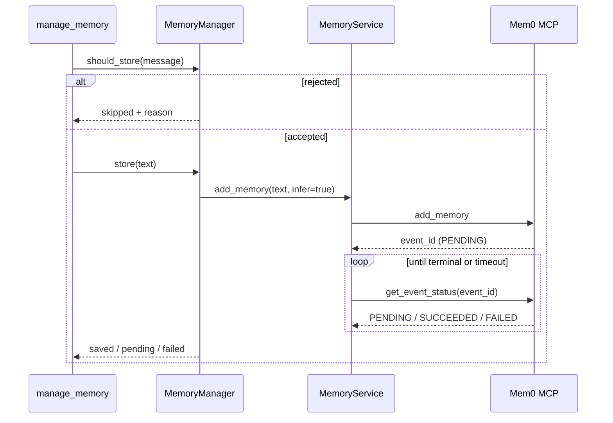
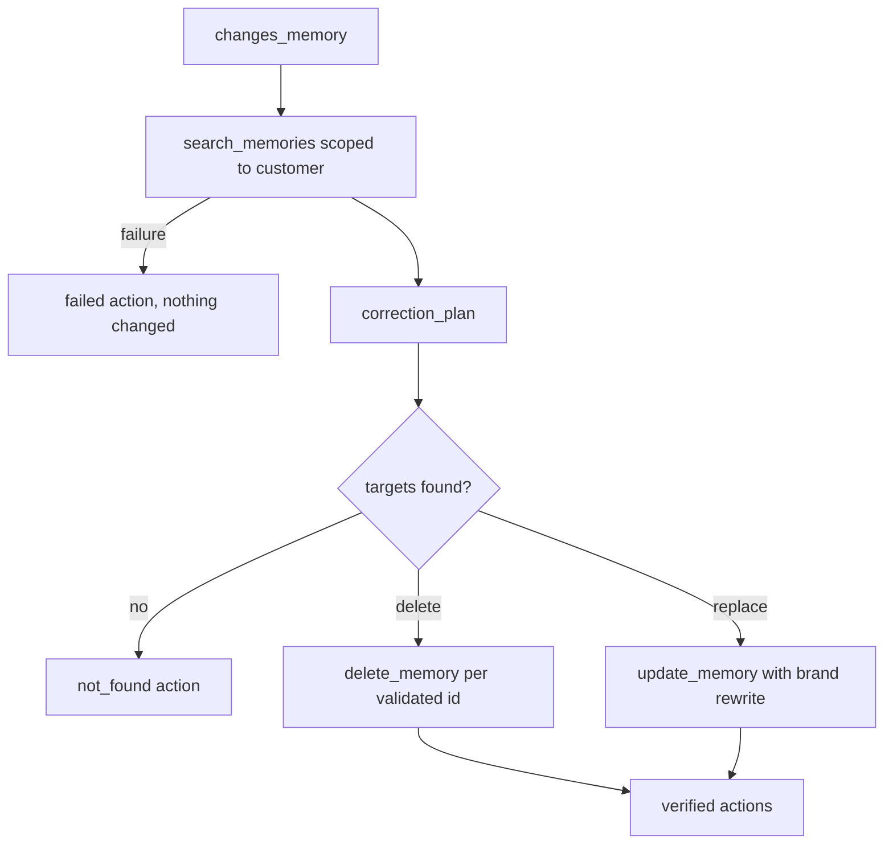

# Memory workflow

## 1. Ownership

| Layer | Owns |
|---|---|
| `memory_client.py` | MCP session, auth, tool discovery, schema adaptation |
| `memory_service.py` | Scoped operations, event polling, isolation |
| `memory_manager.py` | Durable-vs-temporary policy, correction planning, truthful reporting |
| `nodes.manage_memory` | Deciding which operations the turn needs |
| Mem0 | Extraction, deduplication, merging, superseding |

Mem0's `add_memory` runs with `infer=true`, so the application no longer runs an
Ollama preference-extraction pipeline or `SequenceMatcher` duplicate detection.

## 2. Verified MCP tools

Discovered live from `https://mcp.mem0.ai/mcp`:

`add_memory`, `search_memories`, `get_memories`, `get_memory`, `update_memory`,
`delete_memory`, `delete_all_memories`, `delete_entities`, `list_entities`,
`list_events`, `get_event_status`.

Key schemas:

| Tool | Input |
|---|---|
| `add_memory` | `text` or `messages`, `user_id`, `metadata`, `infer` (all optional) |
| `search_memories` | `query`, `filters`, `top_k`, `threshold`, `rerank` |
| `update_memory` | `memory_id` (required), `text`, `metadata` |
| `delete_memory` | `memory_id` (required) |
| `get_event_status` | `event_id` (required) |

`add_memory` returns `{"event_id": "...", "status": "PENDING"}`; the memory is
created asynchronously. `get_event_status` returns
`status` (`PENDING`/`SUCCEEDED`/`FAILED`), `results[].id` (created memory ids),
`results[].data.memory` (stored text) and `error`.

## 3. Write flow

- Timeout (`MEMORY_EVENT_TIMEOUT_SECONDS`, default 15 s) is reported as
  `pending`, never `saved`.
- A missing `event_id` is reported as `pending` with an explanation that
  completion could not be verified.
- The UI shows saved, pending and failed outcomes separately.

## 4. Policy

`MemoryManager.should_store` rejects:

- temporary scope (`this time`, `as a gift`, `for my trip`, ...);
- withdrawal wording (`forget`, `stop remembering`);
- one-off budgets without product context or stable wording;
- statements without stable-preference language.

Accepted text is the customer's sentence; Mem0 extracts the structured memory.
The confirmation uses the text returned by the completed event when available.

## 5. Corrections

- Only ids from the scoped search become targets.
- A negated brand is the *old* preference; a positive brand is the new one.
- `"I prefer JBL, not Sony."` → update Sony records to JBL.
- `"I no longer prefer Sony."` / `"Forget that I prefer Sony."` → delete matching
  Sony records.
- No identifiable target → `not_found`; nothing is deleted.
- `delete_all_memories` is **never** used for a single preference correction.
- `MemoryService.update_memory`/`delete_memory` re-verify ownership through a
  scoped `get_memories` before calling the tool.

## 6. Isolation

- Every read uses `filters={"AND":[{"user_id": customer_id}]}`.
- Returned records whose `user_id` differs are dropped defensively.
- `customer_id` → Mem0 `user_id` is the only mapping.
- Jev never receives the customer id or memory text.

## 7. Verification status

Verified live against Mem0 Cloud:

- tool discovery and schemas;
- `add_memory` → `event_id`/`PENDING`;
- `get_event_status` → `SUCCEEDED` with created id and text;
- search returning stable ids and `user_id`;
- delete of the disposable test record.

The unit suite exercises the real service code with a fake MCP transport for
policy, pending/failed events, corrections and isolation. The live test
`tests/test_memory.py::test_live_mem0_add_search_isolation_and_delete` is
skipped unless `MEM0_API_KEY` is exported.

## 8. Restart behaviour

Mem0 persists independently of the process. Restarting Streamlit clears
LangGraph checkpoints but not memories; the UI's memory panel re-reads them on
demand.
