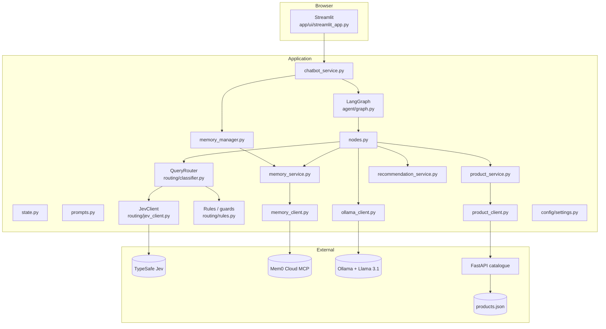

# Overall architecture

## 1. Purpose

A small retail shopping assistant that remembers stable customer preferences in
Mem0 Cloud and applies them later, while obeying the current explicit request.
A Jev-based query router ensures each message executes only the operations it
needs instead of running every node on every turn.

## 2. Component diagram

## 3. Boundaries

| Boundary | Rule | Reason |
|---|---|---|
| UI ↔ application | UI calls `chatbot_service` only | A future FastAPI `POST /chat` can reuse it |
| Chatbot ↔ Streamlit | no Streamlit import outside `app/ui` | testable core |
| Router ↔ execution | Jev returns flags, Python returns node names | model can never execute an arbitrary node |
| Chatbot ↔ memory | only `memory_service` speaks MCP | scoping and schema adaptation centralised |
| Chatbot ↔ catalogue | never reads `products.json` | FastAPI remains the source of truth |
| LLM ↔ selection | LLM extracts/explains; Python selects | no invented products |
| Memory ↔ chat | Mem0 vs LangGraph checkpoint | clearing chat keeps preferences |

## 4. Components

### Frontend
Chat history, customer selection, product cards, service status, route
diagnostics and memory management controls. No business logic.

### Service layer
Validates identifiers, invokes the graph with `thread_id=session_id`, returns a
`ChatResponse` including route, guards, execution path, memory actions/events
and errors. Exposes status and memory-management helpers.

### Routing (`app/routing/`)
- `models.py` — validated `RouteDecision`.
- `questions.py` — five Noul questions plus intent/follow-up Choice.
- `jev_client.py` — HTTP transport, error categories.
- `rules.py` — shortcuts, guards, brand polarity, fallback classifier.
- `classifier.py` — orchestration, reconciliation, step planning.

### Agent (`app/agent/`)
Nine nodes: `prepare_turn`, `route_query`, `manage_memory`,
`retrieve_memory`, `understand_request`, `search_products`,
`recommend_products`, `generate_response`, `finalize_turn`. Shared conditional
edges consume the ordered plan.

### Memory (`app/memory/`)
- `memory_client.py` — one authenticated MCP session on a background loop.
- `memory_service.py` — scoped add/search/list/update/delete, ownership checks,
  async event polling.
- `memory_manager.py` — durable-vs-temporary policy, correction planning,
  truthful outcome reporting.

### Products and recommendations
`product_service` fetches category/budget candidates; `recommendation_service`
owns filtering and ranking. Both are unchanged apart from accepting brand
exclusions from the router/grounding layer.

### LLM
Ollama handles requirement extraction, product explanations, comparisons and
normal conversation. Memory answers and confirmations are deterministic.

## 5. Technology decisions

- **Jev** because zero-shot classification of routing intent is the one place a
  model earns its cost; a 64k context and calibrated probabilities beat a
  512-token specialised encoder for this POC.
- **Deterministic guards** because corrections and greetings are high-impact and
  must not depend on a probability.
- **Mem0 MCP only** to prove hosted-memory interoperability; no SDK/REST fallback.
- **Ollama** so the POC runs without paid LLM keys for generation.
- **FastAPI + JSON** for an independent, synthetic catalogue.
- **No database** — Mem0 satisfies persistence.

## 6. Failure philosophy

- Jev down → rules routing, `source="fallback"`, turn still completes.
- Mem0 down → answer without personalisation; never fabricate memory.
- Mem0 write pending → reported as pending, never saved.
- Catalogue down → explicit message, no products invented.
- Ollama down → deterministic extraction and honest partial reply.
- Invalid model JSON → validation failure → deterministic fallback.

## 7. Verification status

- 173 unit/integration tests pass; 2 live tests are skipped without credentials.
- Live Mem0 verified manually: tool schemas, `add_memory` event id, event status,
  search ids/user scope, deletion.
- Live Jev could not be exercised in this environment because
  `TYPESAFE_API_KEY` is not set; the HTTP contract was verified against the
  published API reference and is covered by a skipped live test.
- Ollama and the product API are exercised through fakes in tests; the running
  services were not required for the suite.

## 8. Known limits

- Brand hints in the router duplicate the catalogue brand list for guard
  purposes; the catalogue remains authoritative for products.
- Feature-only memory corrections report "not found" rather than guessing.
- In-memory checkpoints are per process; conversation context is lost on restart
  while Mem0 preferences persist.
