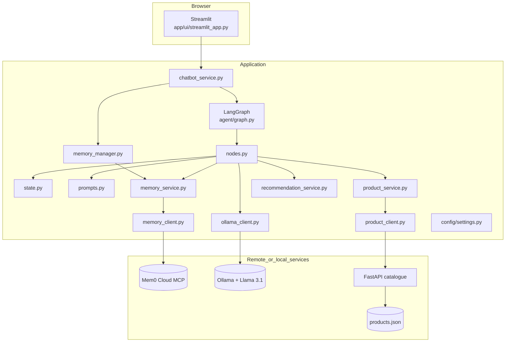

# Overall architecture

## Purpose

The POC demonstrates one capability well: a shopping assistant that remembers
stable customer preferences in Mem0 Cloud and applies them to later conversations,
while still obeying the customer's current explicit request.

It is intentionally small: one LangGraph workflow, one product API, one UI, one
memory provider. There is no multi-agent system and no chatbot FastAPI backend.

## Component diagram

## Boundaries and why they exist

| Boundary | Rule | Reason |
|---|---|---|
| UI ↔ application | UI calls `chatbot_service` only | A future FastAPI `POST /chat` can reuse the same function. |
| Chatbot ↔ Streamlit | No Streamlit import outside `app/ui` | Keeps core logic testable and portable. |
| Chatbot ↔ memory | Only `memory_service` talks to `memory_client` | MCP details stay in one place; scoping is enforced centrally. |
| Chatbot ↔ product data | Application never reads `products.json` | The FastAPI service is the single catalogue source. |
| LLM ↔ product selection | LLM explains; Python selects | Prevents invented products/prices. |
| Long-term memory ↔ chat history | Mem0 vs LangGraph checkpoint | Clearing chat must not delete preferences. |

## Responsibilities

### Frontend — `app/ui/streamlit_app.py`
Renders chat history, handles customer selection, shows product cards, service
status and memory management controls. It calls `process_message`,
`list_customer_memories`, `delete_customer_memory`, `clear_customer_memories` and
`check_services` from the service layer. It contains no prompt, filtering, MCP or
graph logic.

### Service layer — `app/services/chatbot_service.py`
Validates `customer_id` / `session_id` / message, invokes the compiled graph with
`thread_id=session_id`, maps the graph state to a validated `ChatResponse`, and
exposes status/memory helpers. No Streamlit import (covered by a test).

### Agent — `app/agent/`
- `state.py`: `AgentState` TypedDict; all fields documented.
- `prompts.py`: three system prompts and three user-prompt builders.
- `nodes.py`: seven nodes plus Pydantic validation, deterministic grounding,
  precedence resolution and heuristic fallbacks.
- `graph.py`: sequential `StateGraph`, `InMemorySaver` checkpointer, production
  dependency wiring.

### Memory — `app/memory/`
- `memory_client.py`: one authenticated Streamable HTTP MCP session owned by a
  background asyncio task; tool discovery; schema-adaptive arguments; safe result
  parsing; explicit auth/timeout/tool errors.
- `memory_service.py`: customer-scoped `add`, `search`, `list`, `update`,
  `delete`, `delete_all`, ownership verification, isolation filtering.
- `memory_manager.py`: persistent vs temporary classification, duplicate
  detection, write reporting.

### Products — `app/products/`
- `product_client.py`: HTTP calls to the FastAPI API with typed errors.
- `product_service.py`: candidate retrieval (category + budget superset), cached
  brand list, health helper.

### Recommendations — `app/recommendations/recommendation_service.py`
Pure functions: hard filtering, deterministic ranking, optional limit.

### LLM — `app/llm/ollama_client.py`
Ollama `/api/chat` calls, model availability, safe JSON extraction from model
output, explicit exceptions.

### Backend — `backend/`
FastAPI app with `/health`, `/products`, `/products/search`,
`/products/{product_id}`. Catalogue filtering lives in
`backend/routes/products.py`; sample data lives in `backend/data/products.json`.

## Technology decisions

- **Streamlit first** because it makes the POC demonstrable without a custom
  frontend; the service layer keeps it replaceable.
- **LangGraph** because state, node order and checkpointed conversation context
  are explicit and testable.
- **Mem0 Cloud via MCP only** to prove interoperability with the hosted memory
  service and to avoid running memory infrastructure locally.
- **Ollama** because the POC should run locally without paid LLM API keys.
- **FastAPI + JSON** to keep the catalogue independent and obviously synthetic.
- **No database** because the POC's persistence requirement is satisfied by Mem0.

## Failure philosophy

Every external dependency is optional at runtime except the ones needed for the
current action:
- Mem0 down → answer without personalisation, report memory unavailable, do not
  save or claim success.
- Product API down → no recommendations, explicit message.
- Ollama down → deterministic requirement fallback and a response that says the
  LLM explanation is unavailable.
- Invalid LLM JSON → validation error → deterministic fallback.

The application never silently substitutes fake live results.

## Known verification limits

The repository was developed in an environment without `MEM0_API_KEY`, so live
Mem0 operations could not be executed. Unit tests exercise the real MCP client
code with a fake session, and a live test plus diagnostics script are provided.
Ollama and the product API were exercised for real.
