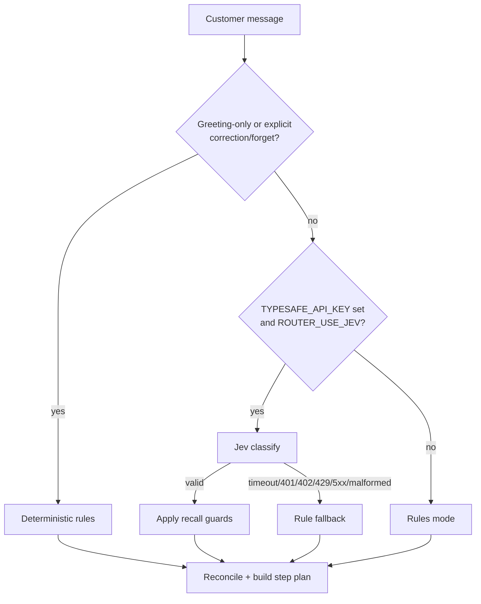

# `app/routing/` package

## 1. Purpose

Decides **which operations a customer message needs** and returns two things:

1. a validated `RouteDecision` (what the message is asking for);
2. an ordered, allowlisted LangGraph step plan (`pending_steps`).

Jev (TypeSafe System One) is the primary classifier. It never writes
customer-facing text, never picks products and never authorises a memory write.
Python owns all irreversible decisions.

## 2. Module map

| File | Responsibility |
|---|---|
| `models.py` | `RouteDecision`, `Intent`, `FollowupAction`, probability validation |
| `questions.py` | The five Noul questions and two Choice questions sent to Jev |
| `jev_client.py` | HTTP transport for `POST /v1/systemone`, error mapping |
| `rules.py` | Deterministic shortcuts, recall guards, brand polarity, fallback |
| `classifier.py` | Orchestration, intent reconciliation, step planning |

`__init__.py` re-exports `QueryRouter`, `RouteDecision`, `Intent`,
`FollowupAction` and `build_step_plan`.

## 3. Precedence



Rules also act as guards after Jev, never as a second opinion that discards a
valid classification (except the documented temporary-scope rule).

## 4. Inputs and outputs

```python
router = QueryRouter(settings)
decision, plan = router.route(
    "Which is better?",
    history=[{"role": "user", "content": "Show me headphones"}],
    previous_recommendations=[{"product_id": "HP001", ...}],
)
```

`plan` is always a list of node names from `PLANNED_NODES`, contains exactly one
`generate_response` and one `finalize_turn`, and contains no duplicates.

## 5. Interaction with the graph

`app/agent/nodes.py::route_query` calls `QueryRouter.route`, stores
`route`/`pending_steps`/`router_usage`/`route_guards` in `AgentState`, and
`app/agent/graph.py` dispatches the head of `pending_steps` through the shared
`next_step` conditional edge.

## 6. Failure handling

`QueryRouter.route` never raises for routing problems:

| Failure | Result |
|---|---|
| Jev timeout / transport error | `source="fallback"`, `confident=False`, rules decision |
| Jev 401/403 | fallback with `jev_unavailable: JevError` guard |
| Jev 402 (no credits) | fallback |
| Jev 429 / 5xx | one retry, then fallback |
| Non-JSON or missing answer | fallback |
| Unsupported intent label | fallback |
| `TYPESAFE_API_KEY` missing | rules, guard `jev_not_configured` |

The turn still completes; routing quality degrades and the diagnostic is visible
in the UI.

## 7. Testing

`tests/test_routing.py` covers the contract, every failure mode, every guard,
brand polarity, the 15 required scenarios and the planner invariants. A live Jev
test is skipped unless `TYPESAFE_API_KEY` is exported.
