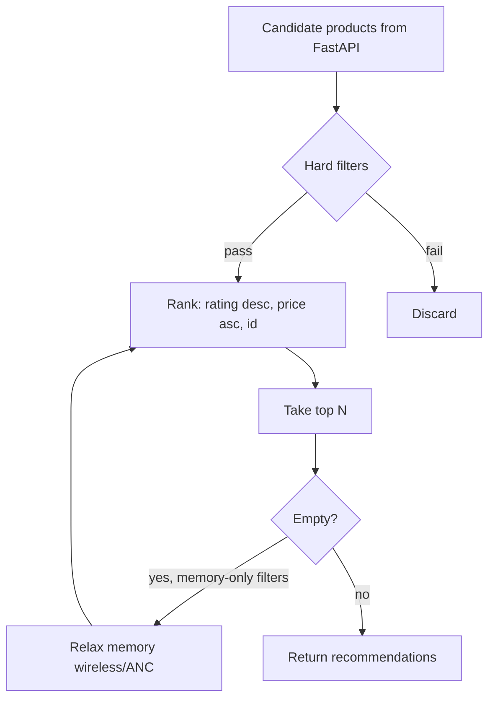

# Recommendation workflow

## Principle

The LLM never chooses products. `recommendation_service.py` applies hard filters
and transparent ranking to catalogue data, and the LLM only writes an explanation
for the products it is given.

## Inputs

A list of product dictionaries from the FastAPI catalogue:

```json
{
  "product_id": "HP007",
  "name": "JBL Tune 520BT Wireless On-Ear Headphones",
  "brand": "JBL",
  "category": "headphones",
  "price": 2499,
  "rating": 4.2,
  "wireless": true,
  "noise_cancellation": false,
  "features": ["Bluetooth", "On-Ear", "Lightweight", "Long Battery Life"]
}
```

and resolved requirements:

```json
{
  "category": "headphones",
  "brand": "JBL",
  "max_budget": 3000,
  "wireless": true,
  "noise_cancellation": null,
  "required_features": [],
  "excluded_features": [],
  "excluded_brands": [],
  "excluded_product_ids": []
}
```

## Flow



## Hard filters

| Requirement | Rule |
|---|---|
| `category` | case-insensitive equality |
| `brand` | string or list; case-insensitive membership |
| `max_budget` | `price <= max_budget` |
| `wireless` | exact boolean match (wired products excluded when true) |
| `noise_cancellation` | exact boolean match |
| `required_features` | every feature present, case-insensitive |
| `excluded_features` | none of these features present |
| `excluded_brands` | brand not in list |
| `excluded_product_ids` | product id not in list |

Products missing a numeric price with a budget set are excluded rather than
guessed.

## Ranking

```python
sorted(products, key=lambda p: (-rating, price, product_id))
```

1. Higher rating first.
2. Lower price when ratings are equal.
3. Product ID as a stable tie-breaker.

`settings.max_recommendations` (default 5) truncates the ranked list.

## Soft memory relaxation

Memory-derived wireless/ANC values are personalisation, not an explicit command.
If applying them produces zero results, `recommend_products` retries without them
and records `relaxed_preferences`. Example:

- Memory: Sony + noise cancellation.
- Request: "JBL headphones under ₹3,000 this time."
- ANC would exclude both affordable JBL models.
- Relaxed ANC → two JBL products; the reply/UI note says the remembered ANC
  preference was relaxed.

Explicit current constraints (brand, budget, category, explicitly requested
wireless/ANC) are never relaxed.

## Empty results

The engine returns `[]`. The response node says no catalogue product matches the
requirements and suggests raising the budget or removing a requirement. It never
invents an alternative or silently falls back to unrelated products.

## Example

Memory: "Usually prefers Sony headphones with noise cancellation."
Request: "Show me wireless Sony headphones under ₹5,000."

Candidates: Sony headphones ≤ 5000 → WH-CH520 (₹4,490, 4.3), MDR-ZX110 (₹1,490,
wired). Hard filters remove wired; result: WH-CH520.

## Testing

`tests/test_recommendations.py` covers every filter, ranking order, no-match cases
and input immutability. `tests/test_end_to_end.py` runs the engine on the real
catalogue through FastAPI.
