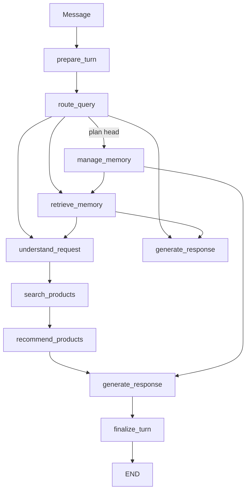

# Routing workflow

## 1. What routing decides

A customer message is classified into independent capabilities, then converted
into an ordered plan. Only the planned nodes run.

## 2. Precedence

1. **Deterministic shortcut** — bare greeting or explicit correction/forget.
2. **Jev** — five capability probabilities plus intent and follow-up action.
3. **Recall guards** — product signal, durable preference, temporary scope,
   previous-context refinement, personalisation phrases.
4. **Rule fallback** — Jev missing, failing, timing out or returning unusable
   output; also the normal mode when `TYPESAFE_API_KEY` is unset.

## 3. Step-planning rules

| Condition | Consequence |
|---|---|
| `changes_memory` or `states_preference` | `manage_memory` first (corrections apply before retrieval) |
| `needs_personalisation` or `intent == memory_question` | `retrieve_memory` |
| `wants_products` and not comparing/explaining earlier products | `understand_request` → `search_products` → `recommend_products` |
| `compare`/`explain` with a previous shortlist | no extraction, no catalogue fetch |
| every turn | exactly one `generate_response`, then `finalize_turn` |

A combined turn runs memory management *and* the shopping pipeline. Memory writes
run before retrieval, so "I no longer prefer Sony, show me alternatives" does not
re-read the stale preference.

## 4. Required scenarios

| Customer message | Route | Executed nodes |
|---|---|---|
| "Hi" | greeting | generate, finalize |
| "What is noise cancellation?" | general_question | generate, finalize |
| "What do you remember about me?" | memory_question | retrieve, generate, finalize |
| "I usually prefer Sony headphones" | preference_statement | manage, generate, finalize |
| "Forget that I prefer Sony" | memory_correction | manage (delete), generate, finalize |
| "I no longer prefer Sony" | memory_correction | manage (delete), generate, finalize |
| "Forget Sony. I prefer JBL." | memory_correction + preference | manage (delete Sony, store JBL), generate, finalize |
| "Show me earbuds under ₹5,000" | product_search | understand, search, recommend, generate, finalize |
| "I prefer Sony; show me something under ₹5,000" | product + preference | manage, understand, search, recommend, generate, finalize |
| "Recommend headphones based on my preferences" | product + personalisation | retrieve, understand, search, recommend, generate, finalize |
| "I don't like JBL anymore; show me alternatives" | correction + product | manage (delete JBL), understand (exclude JBL), search, recommend, generate, finalize |
| "Remember I like ANC and show me options" | preference + product | manage (store), understand, search, recommend, generate, finalize |
| "Show me cheaper ones" | product_followup / refine | understand (budget below previous minimum), search, recommend, generate, finalize |
| "Which is better?" | product_followup / compare | generate (comparison), finalize |
| "Tell me more about the second one" | product_followup / explain | generate (explanation), finalize |
| "I prefer JBL, not Sony. Recommend something based on my preferences." | correction + preference + product + personalisation | manage (update Sony→JBL), retrieve, understand, search, recommend, generate, finalize |

## 5. Deterministic guarantees

- Greetings and general questions never call the product API or Mem0.
- A product-only request never calls Mem0.
- A preference-only request never calls the product API.
- Corrections only use ids returned by a scoped search.
- A compare/explain follow-up never performs a new catalogue search.
- Every plan ends at `finalize_turn` and produces exactly one response.
- Invalid or repeated plan entries cannot loop: unknown steps route to
  `finalize_turn`, and the visit count is capped (`MAX_VISITED_STEPS = 12`).

## 6. Diagnosability

Every turn exposes:

- `route.intent`, capability flags and `intent` probabilities;
- `route.source` (`jev`, `jev+guards`, `rules`, `fallback`);
- `route.confident`;
- `route_guards` (each applied guard named);
- `router_usage` (`model`, `input_tokens`, `latency_ms`);
- `execution_path` (nodes actually visited).

## 7. Cost and latency

A routing request contains the message plus up to two prior turns (~400–600
tokens). At $0.042 per million input tokens, a turn costs roughly **$0.00002**;
the API's `usage.input_tokens` is surfaced in `router_usage` so the real figure
can be checked. Jev adds ~150–500 ms and is capped at 2 seconds before the rules
fallback takes over.

## 8. Privacy

Jev receives the current message and at most two prior turns. It never receives
`customer_id`, saved memory contents, or catalogue data.
